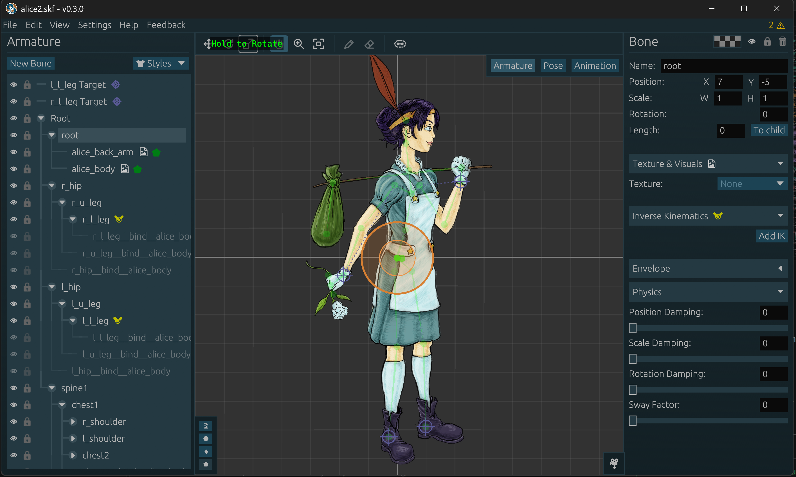

	<h1>Keyternity</h1>
	<h3>A 2D skeletal animator built for artists</h3>
	

		<a href="docs/TOPOLOGY_TOOLS.md">✏️ Toolbar &amp; Topology Tools</a> -
		<a href="docs/BIND_POSE.md">🦴 Bind Pose Skinning</a> -
		<a href="docs/DRAGONBONES_IMPORT.md">📥 DragonBones Import</a> -
		<a href="docs/DRAGONBONES_EXPORT.md">📤 DragonBones Export</a> -
		<a href="docs/FFMPEG.md">🎞️ FFmpeg</a>
	

	

		
	

## Keyternity

Keyternity is a 2D skeletal animation editor: rig a character from layered art,
animate it with keyframes, inverse kinematics and mesh deformation, and export it
for games, apps and other runtimes.

It's the animation tool for [Inkternity](https://github.com/inviti8/inkternity),
an infinite-canvas comic app that plays 2D skeletal rigs. Keyternity speaks
**DragonBones**, the format Inkternity embeds, in both directions, and it focuses
on artist-facing workflow: standard bind-pose skinning, a Pose mode for testing
rigs, and a display that keeps art and rig visually apart.

### A fork of SkelForm

Keyternity is a fork of [Retropaint/SkelForm](https://github.com/Retropaint/SkelForm).
Everything not listed below comes from SkelForm: the editor, the renderer,
bones, meshes, styles, animation, export and the `.skf` format.

Keyternity and SkelForm **diverged on 2026-09-30**, from upstream commit
`68b66d21` (2026-09-11). Keyternity's additions were offered upstream first
([#12](https://github.com/Retropaint/SkelForm/pull/12),
[#13](https://github.com/Retropaint/SkelForm/pull/13)), but they're outside the
scope SkelForm wants to maintain. So Keyternity is developed independently and
doesn't track upstream; useful upstream fixes may be picked over case by case.

Rigs are still `.skf` files, but Keyternity's IK constraints replaced SkelForm's
IK families, so rigs with IK no longer play on SkelForm's runtimes. Export to
DragonBones for game engines. Older files lose their IK.

## What Keyternity adds on top of SkelForm

- **Inverse kinematics constraints** — IK the way Blender, Spine and DragonBones
  do it: *Add IK* on the bone at the end of a chain, set how many bones above it
  the IK turns, and move its target. Adding IK never moves a bone or its art,
  chains can be drawn bent, and joints bend as drawn or forced clockwise or
  counter-clockwise. Weight (animatable, for IK/FK switching) and *Copy Target
  Rotation* (for hands and feet), and a *Target Space*: World grounds feet, while
  a bone such as the chest makes a hand follow the upper body. Targets draw as a
  circle with a cross, with a dotted line to the bone they follow. Two-bone chains
  solve exactly; longer ones use FABRIK. Chains hanging off other chains solve in
  order. Replaces SkelForm's IK families ([design](docs/IK.md))
- **Set Key, Key All and Delete Key** — buttons in the timeline (I, Shift+I and
  Alt+I) key the selected bones' position, rotation and scale on the current
  frame as shown, to hold a pose, or the whole rig (every bone without a texture,
  IK targets included), or remove the selected bones' keys there. A **Breakdown**
  slider keys the selected bones partway between their previous and next poses.
  Editing a bone while animating still keys it automatically
- **Easing presets** — besides Linear, Sine and Snap: Quad, Cubic, Quart, Quint,
  Expo, Circ and Back (overshoot), each In, Out and In-Out. They're the standard
  cubic-Bézier curves, so they export exactly to DragonBones
- **Reparenting keeps bones in place** — dragging a bone onto another in the
  hierarchy keeps its world position, rotation and scale, so neither it nor its
  children move, even under rotated or scaled parents
- **Bone length** — bones can have a length, drawn as a blade from head to tail.
  Drag the tail handle to change it without turning the bone (Ctrl+drag to aim
  it too), or use *To child* in the bone panel. Photoshop import points group
  bones at their child group, and DragonBones import and export keep lengths.
  The groundwork for envelope skinning ([design](docs/ENVELOPES.md))
- **Bind to Skeleton** — one click skins a mesh, as with Blender's automatic
  weights or Max's Skin modifier: Bind Pose is turned on, every skeleton bone in
  reach gets a bind, and every vertex is weighted from the bones' **envelopes**
  (a capsule along each bone, full inside an inner radius and fading out to an
  outer one, with four falloff curves and an Absolute mode for rigid pieces).
  Bones without a texture are the skeleton by default. Weights stay live as you
  change envelopes, lengths or the setup pose, except vertices you weight by hand,
  which are kept. Up to 4 bones per vertex by default, and vertices outside every
  envelope are flagged. **Clear All Binds** (after a confirmation) removes a mesh's
  binds and weights to start the skinning over, leaving the art as drawn. The **Envelope tool** (Shift+E) shows the capsules and has
  handles to resize them, and colors each mesh vertex by the selected bone's weight,
  blue to red. **Paint Weights** (Shift+W) brushes a bone's weight onto a mesh
  with Add, Subtract and Smooth, and hand weights are normalized: raising one
  bone's share lowers the others, so a vertex's weights always total 100%.
  Its **Lasso** assigns everything inside an outline in one go
  ([design](docs/ENVELOPES.md))
- **Timeline** — navigate by the visible range, with a range bar under the rows
  and an *End* frame that can follow the last key or be set. Rows are grouped per
  bone, with small key marks and summaries, and bone headers stay pinned while
  scrolling. Selected keys scale in time by dragging or by a typed factor or
  length ([design](docs/TIMELINE.md))
- **Animation layers** — Override and Additive layers in a stack above the rows,
  each with weight, mute, solo and lock. Layers can loop on their own (looped play
  mode), play another animation (linked layers), or add procedural motion
  (generators such as sine waves, bakeable to keys). Exports flatten the layers
  into one ([design](docs/TIMELINE.md))
- **Shapes** (morph targets) — named vertex offsets on a mesh, blended by weight
  and applied before skinning, so they ride the bones. Sculpt them with a soft
  brush, mirror them, or capture one from a pose; key their weights through
  layers. DragonBones export bakes them into FFD keys
  ([design](docs/LIP_SYNC.md#4-shapes-morph-targets))
- **Face rig** — the standard face shapes (FaceBot's Mixamo set: blinks, brows,
  smiles, lips, jaw…) and *Set Up Face*, which adds a 13-control rig that drives
  them. Pose it in the **Face Rig panel**: FaceBot's mask, lit and deforming with
  its manipulators. Left-drag moves, right-drag twists, middle-drag works the eyes'
  scale and the lips' and jaw's depth, and Key and Reset sit above the mask
  ([design](docs/LIP_SYNC.md#65-the-face-rig-2d-after-facebot))
- **Generated faces** — mark ~30 landmarks on a face mesh and *Generate Face*
  builds the standard shapes from them, deriving the other side by mirroring
  (front views) or a cylinder model (three-quarter views), with a profile mode
  ([design](docs/LIP_SYNC.md#67-generating-the-face-landmarks-and-automatic-shapes))
- **Dialog audio** — *+ Audio* (or drop a file) places wav, mp3, ogg, flac or m4a
  clips on an animation's timeline, embedded in the `.skf`. Each clip has a lane
  with its waveform, drag to move, volume and mute. It plays in sync, is heard
  while scrubbing, and is mixed into MP4 exports
  ([design](docs/LIP_SYNC.md#5-dialog-audio-in-animations))
- **Lip sync** — the *Lip* button on an audio lane keys the mouth from the line's
  words, spread over the speech in the clip, or from its loudness alone. It works
  on a face rig, on viseme shapes, or on a drawn mouth that swaps textures, in
  Preston Blair's 10 visemes, Oculus's 15 or a simple 5, with lead, hold, smoothing
  and intensity. The keys go in the clip's own locked Lip Sync layer, which
  regenerates when the words change, or can be baked. Text rules for English,
  German, French, Brazilian Portuguese, Finnish and Lithuanian are ported from
  [TalkingHead](https://github.com/met4citizen/TalkingHead). **Transcribe**
  listens to a recording with [whisper.cpp](https://github.com/ggml-org/whisper.cpp),
  downloaded on first use like FFmpeg ([design](docs/LIP_SYNC.md#7-auto-lip-sync))
- **Voice generation** — the **Dialog** window: type a line, pick a voice,
  Generate. Each generation is kept as a take to listen to and swap. The take in use
  is placed on the timeline and lip-synced. Voices: Kokoro on this computer (through
  sherpa-onnx, downloaded on first use), the computer's own voices, ElevenLabs with
  your API key, and Chatterbox voice cloning (with the voice owner's consent)
  ([design](docs/LIP_SYNC.md#8-voice-generation-dialog-from-text))
- **AI agent** — Keyternity runs a local MCP server, so an agent such as Claude
  Code can work on the open rig. For skinning, it reads the rig, looks at rendered
  pictures of the art and bones, assigns drawn parts to bones, and test-poses the
  rig to find folds and stretching. For dialog, it speaks or places lines,
  lip-syncs them and keys expressions. Each piece of work ends with a review page
  in the browser. Connect it once from *Settings → Agent*
  ([skinning](docs/AI_SKINNING.md), [dialog](docs/LIP_SYNC.md#9-agent-mcp-tools))
- **Canvas toolbar** — a toolbar above the canvas with Move, Rotate and Scale,
  the navigation tools, the mesh tools, and the mesh actions (Trace, Center,
  Reset, Re-triangulate). The active tool's options sit on its right
  ([design](docs/TOPOLOGY_TOOLS.md))
- **Hand-made mesh topology** — the triangles you make are the mesh. Adding a
  vertex splits only the triangle or edge it lands on; nothing re-triangulates
  the whole mesh behind your back, so imported and hand-built topology survives
  editing. Right-click dissolves a vertex (filling the gap) or removes a
  triangle; Re-triangulate runs the old automatic triangulation on demand
- **Pen tool** (K) — draw edges on a mesh, modelled on Blender's Knife. Click to
  place points, each joined to the last. A cut across the mesh splits the
  triangles it crosses; a closed loop outside it, or a cut out from its edge and
  back, fills new area; holes stay holes. A live preview shows the new faces
  before Enter applies them. Snaps to vertices and edges (Ctrl: an edge's
  midpoint, Shift: free), with a 45° lock (C)
- **Eraser tool** (Shift+K) — click or drag over vertices and edges to erase
  them. Dissolve (the default) keeps the surface and fills the gap; Delete leaves
  a hole. Ctrl swaps the two for a stroke, and each stroke is one undo step
- **Navigation tools** — Pan (H), Zoom (click, Alt+click, or drag), and Fit
  (Home) to frame the selected bone or the whole rig. Zooming, including with the
  scroll wheel, keeps the point under the cursor still, and steps by the same
  ratio at any zoom level
- **DragonBones import** — File › Open a `<name>_ske.json`, with its
  `_tex.json`/`_tex.png` atlas pages. You get bones, slots and display swaps,
  draw order, color, eased and curved keyframes, IK, and weighted meshes; trimmed
  and rotated atlas regions are handled. IK chains, and bones that don't inherit
  their parent's transform, are baked from a port of the DragonBones runtime's
  own bone update and IK solver. Anything that can't be carried over exactly (FFD
  mesh deform, nested armatures, skew, color offsets, events) is listed after
  import. Checked frame by frame against the reference DragonBonesCPP runtime: 40
  of its 43 sample rigs match within ~1 px
  ([verification](docs/DRAGONBONES_VERIFY.md))
- **DragonBones export** — Export › DragonBones writes DragonBones 5.5 JSON
  (`_ske.json` + `_tex.json` + `_tex.png`) for DragonBones runtimes. It covers
  bones, textures, meshes and weights, animations with easing, draw order, and
  visibility; IK is baked into rotations. Bind-posed meshes export as native
  DragonBones skinning. Round trips (Keyternity → DragonBones → Keyternity) match
  within 0.013 px
- **Bind Pose skinning** — standard, 3D-style skinning for meshes blended across
  several bones. Vertices follow each bone relative to where it was when bound,
  so weights can be edited freely without vertices jumping, and the bind pose
  tracks the setup pose (Blender-style). This works through greyed-out,
  read-only helper bones, with no file-format or runtime changes. Set it per mesh
  or for the whole rig. A warning flags classic multi-bind vertices that would
  sit out of position ([design](docs/BIND_POSE.md))
- **Pose mode** — an Armature | Pose | Animation mode tab. Move bones freely to
  test how meshes deform, without an animation and without touching the rest
  pose. Leaving the tab restores every bone; pose edits stay out of undo history,
  and saves and exports always use the rest pose
- **Attachment display** — Settings › Rendering › *Show textured bones as
  attachments*: bones that show a texture draw as a small dot with a thin line to
  their parent instead of a full bone, keeping the rig visually separate from the
  art. The attachment color is configurable
- **Verified FFmpeg** — video export uses FFmpeg from its official publishers
  only, pinned and checked by SHA-256. The Windows installer downloads the
  official gyan.dev build; Linux and macOS use the system's ffmpeg. The repo
  carries no third-party binaries ([details](docs/FFMPEG.md))
- **Mesh display** — mesh edges draw as thin dotted lines with a faint dark
  outline (Settings › Rendering: dotted, dashed or solid, and width), and stay
  easy to click. While a bind is selected, each of its vertices gets its own
  color, matching a swatch on its row in the bind panel: a pale tint at weight 0,
  full color at weight 1. Hovering a vertex highlights its row. Mesh vertex
  size is adjustable ([design](docs/MESH_DISPLAY.md))
- **Trace** — auto-meshing follows the art's real outline, including concave
  shapes, separate pieces and holes, never covers transparent areas, and fills
  the inside with evenly sized triangles. Detail, padding, density and alpha
  threshold are in the toolbar, with defaults that scale to the texture.
  *Outline* traces just the cut-out shape, to draw the topology by hand
  ([design](docs/AUTO_MESH.md))
- **Photoshop import keeps layers separate** — every visible layer becomes its
  own bone and texture (trimmed to its art), including layers outside groups.
  Groups become parent bones, placed at a `$pivot` layer or at their art's
  center. SkelForm merged each group into one texture
- **Fixes**
  - Unused Textures no longer lists textures that animations swap in
  - "Download ffmpeg" no longer crashes when the app folder isn't writable
  - Crash logs are written to the app data folder (`crash.log` beside
    `config.json`, e.g. `%APPDATA%\keyternity\keyternity\data` on Windows)
    instead of the install folder, which isn't writable, so they were lost
  - Photoshop import no longer crashes on layers that extend past the canvas
    (as GIMP and Photoshop leave them after cropping)

## Inherited from SkelForm

- Bone hierarchies with per-component inheritance, pivots and textures
- Keyframe animation with easing curves and onion skinning
- Meshes with vertex binds, weights and path binds
- Styles: hot-swappable texture sets for outfits and skins
- Physics on bones
- Photoshop (`.psd`) import of layered art
- Export of armatures (`.skf`/`.skfe` with texture atlases), images,
  spritesheets and video
- Runtimes and runtime documentation for integrating rigs in games and apps
  ([skelform.org](https://skelform.org))
- Native desktop builds (Windows, macOS, Linux) and a web build

## Status

Keyternity is under active development. Releases for Windows, macOS and Linux are
on the [releases page](https://github.com/inviti8/keyternity/releases);
Keyternity's versions started fresh rather than continuing SkelForm's.

Keyternity keeps its settings in its own folder (`keyternity`), separate from an
installed SkelForm, and installs alongside it rather than over it. Rig files stay
SkelForm's `.skf` format, but rigs using Keyternity's additions (IK constraints,
layers, shapes, audio) only play fully in Keyternity and its exports.

Optional tools are downloaded on first use rather than bundled, each pinned and
checked against its publisher's SHA-256: FFmpeg for video, whisper.cpp for
transcription, and sherpa-onnx with Kokoro for voices. They live in Keyternity's
data folder.

## Building

Install Rust v1.85.0 or above, then run `cargo run`.

### Linux

Dependencies:

- glib2-dev - required for the `rfd` crate (file dialogs)
- gtk3-dev - ditto above
- libasound2-dev (ALSA) - required for audio playback

Library names may differ across distributions. Video export uses the system's
`ffmpeg`.

### Web

Install [Trunk](https://trunkrs.dev) v0.21.7 or above, and Python 3.13.6 or
above. Then run `web_build.py` to build the `dist` folder. It also fetches the
pinned, checksum-verified ffmpeg.wasm files.

Notable arguments:

- `--serve` - run `localhost:8000` after the build
- `--release` - build for release (requires changing the base url to test locally)

### Native desktop release

`release/release.py` builds a distribution for the platform it runs on: a zip
and an installer (Inno Setup) on Windows, `Keyternity.app` and a `.dmg` on
macOS, a zip on Linux. Run it from the `release` folder; `-nd` skips building
SkelForm's user and dev docs.

### Releasing

Releases are built by GitHub Actions (`.github/workflows/release.yml`) when a
version tag is pushed. The tag must match `Cargo.toml`'s version, since the
app's update check compares the two.

- `python tools/create_release.py` shows the tag it would push
- `python tools/create_release.py --push` tags the current version and pushes it
- `python tools/create_release.py --bump patch --push` raises the version
  first (also `minor` or `major`), commits that, then tags and pushes
- `--suffix rc1` makes a pre-release tag such as `v0.1.0-rc1`

The workflow builds Windows, macOS and Linux in parallel and collects them into
a draft release on GitHub, to review and publish. Every push to `main` also
builds and runs the quick test suites (`.github/workflows/ci.yml`).

### App icons

`assets/icon_SRC.svg` is the master. After changing it, regenerate the window
icon, the Windows `.ico` (also the web favicon) and the macOS `.icns` with
`uv run tools/regen_icons.py` (needs ImageMagick's `magick` on PATH).

### Tests

The integration tests are one test binary, `tests/all/` (one module per file),
so a full run links the app once.

- `cargo test --test all`: everything
- `cargo test --test all -- topology:: pen::`: only some, by module
- `cargo test --test all -- dragonbones_import:: --ignored` (opt-in; needs MSVC and
  a DragonBonesCPP checkout, see [DRAGONBONES_VERIFY.md](docs/DRAGONBONES_VERIFY.md))
- `cargo test --test all -- ffmpeg_download:: --ignored` (opt-in, Windows;
  downloads the pinned FFmpeg build)
- `cargo test --test all -- transcribe:: --ignored` (opt-in; downloads whisper.cpp
  and its tiny model, and transcribes)
- `cargo test --test all -- dialog:: agent_dialog:: --ignored` (opt-in; speaks with
  the system's voices and with Kokoro, which it downloads, about 350 MB)
- `LIPSYNC_PREVIEW_DIR=… cargo test --test all -- lipsync_preview --ignored`
  renders a lip-synced line on FaceBot's mask as frames, to check by eye (see
  `tests/all/lipsync_preview.rs`)

Builds run three jobs at a time (`.cargo/config.toml`) to stay within memory.

## Documentation

- Keyternity's additions: the `docs` folder
- Code: `cargo doc --no-deps --open`
- Editor and runtime usage: SkelForm's
  [user documentation](https://skelform.org/user-docs) and
  [dev documentation](https://skelform.org/dev-docs) still apply to everything
  inherited

## Contribution

Issue reports (bugs and feature requests) are welcome. For pull requests of any
meaningful size, please open an issue first.

## License

Keyternity is distributed under the [GNU General Public License v3.0](LICENSE.md),
the license it inherits from SkelForm. SkelForm is © Retropaint and contributors;
Keyternity's changes are © their authors and released under the same license.
As GPLv3 requires, [`NOTICE`](NOTICE) records the lineage and the modifications.

FFmpeg is not included; it's downloaded from its publishers under its own license
(see [docs/FFMPEG.md](docs/FFMPEG.md)). Neither are whisper.cpp, sherpa-onnx,
Kokoro and its espeak-ng data, or Chatterbox: they're downloaded on first use,
under their own licenses (MIT, Apache-2.0, Apache-2.0 with GPL-3.0 data, and MIT).
The lip-sync text rules are ported from TalkingHead (MIT). `NOTICE` has the
details.

## Acknowledgements & Attributions

Keyternity is built on [SkelForm](https://github.com/Retropaint/SkelForm) by
Retropaint.

From SkelForm:

- Built on top of
  [matthewjberger/wgpu-example](https://github.com/matthewjberger/wgpu-example)
- FABRIK technique by
  [Programming Chaos](https://www.youtube.com/watch?v=NfuO66wsuRg)
- Inverse Kinematics icon by lucysir
- Lock icon provided by
  [boxicons](https://boxicons.com/icons/lock-keyhole?free=true&q=lock-keyhole&p=filled)

DragonBones verification uses the
[DragonBonesCPP](https://github.com/DragonBones/DragonBonesCPP) runtime.
